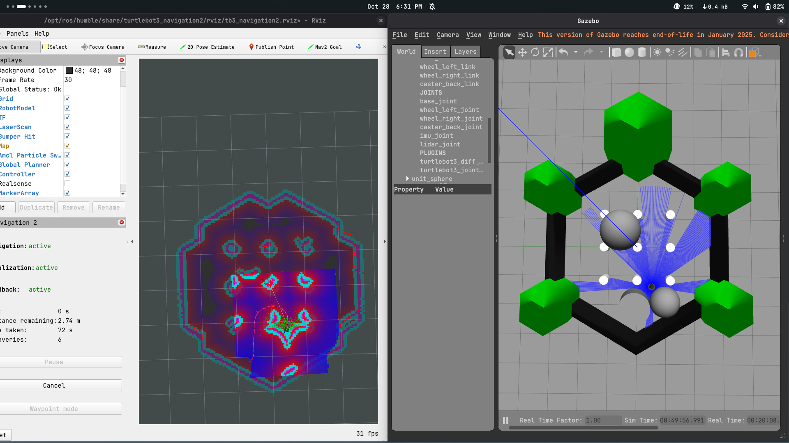

# TurtleBot3 Burger + Nav2 in Gazebo (ROS 2 Humble)

Autonomous navigation of a TurtleBot3 Burger around obstacles, using Nav2 in Gazebo Classic.

**Demo video:** https://youtu.be/pfOOQXsdwNM


## Environment
- Host: Fedora, running Ubuntu 22.04 in a Distrobox container
- ROS 2 Humble, Gazebo Classic, Navigation2, TurtleBot3 packages (all stock)
- DDS: CycloneDDS (see Issues)

## Setup
```bash
sudo dnf install -y distrobox podman
distrobox create -n ros --image ubuntu:22.04
distrobox enter ros
```
Inside the container, install ROS 2 Humble and packages:
```bash
sudo apt update && sudo apt install -y locales software-properties-common curl
sudo locale-gen en_US en_US.UTF-8
sudo add-apt-repository universe
sudo curl -sSL https://raw.githubusercontent.com/ros/rosdistro/master/ros.key -o /usr/share/keyrings/ros-archive-keyring.gpg
echo "deb [arch=$(dpkg --print-architecture) signed-by=/usr/share/keyrings/ros-archive-keyring.gpg] http://packages.ros.org/ros2/ubuntu jammy main" | sudo tee /etc/apt/sources.list.d/ros2.list
sudo apt update
sudo apt install -y ros-humble-desktop ros-humble-gazebo-ros-pkgs \
  ros-humble-navigation2 ros-humble-nav2-bringup ros-humble-turtlebot3* \
  ros-humble-rmw-cyclonedds-cpp

cat >> ~/.bashrc << 'EOF'
source /opt/ros/humble/setup.bash
export TURTLEBOT3_MODEL=burger
export GAZEBO_MODEL_PATH=$GAZEBO_MODEL_PATH:/opt/ros/humble/share/turtlebot3_gazebo/models
export RMW_IMPLEMENTATION=rmw_cyclonedds_cpp
EOF
source ~/.bashrc
```

## Run
Terminal 1 (Gazebo):
```bash
distrobox enter ros
ros2 launch turtlebot3_gazebo turtlebot3_world.launch.py
```
Terminal 2 (Nav2 + RViz), after Gazebo has fully loaded:
```bash
distrobox enter ros
ros2 launch turtlebot3_navigation2 navigation2.launch.py use_sim_time:=True \
  map:=/opt/ros/humble/share/turtlebot3_navigation2/map/map.yaml \
  params_file:=$PWD/params/burger.yaml
```
In RViz: **2D Pose Estimate** (set the robot's start pose), then **Nav2 Goal** (click a destination).
To test dynamic avoidance, place a small (about 0.3 m) cylinder in the robot's path in Gazebo while it drives.

## Config
`params/burger.yaml` is a copy of the stock TurtleBot3 Nav2 params, with costmap
`inflation_radius` and `cost_scaling_factor` tuned to fit the tight arena.

## Issues encountered
| Problem | Cause | Fix |
|---|---|---|
| `ros2: command not found` | Terminal was on the host, not in the container | `distrobox enter ros` in every terminal |
| `gzserver` died (exit 255), robot never spawned; `RTPS_TRANSPORT_SHM Error` | FastDDS shared memory failing inside the container, plus leftover gz processes | Switched to CycloneDDS; `killall -9 gzserver gzclient`; cleared `/dev/shm/fastrtps*` |
| `Service /spawn_entity unavailable` | Gazebo server slow or crashed before the spawner's 30 s timeout | Wait for the world to load, spawn manually with `spawn_turtlebot3.launch.py` |
| Robot hesitates or freezes beside an obstacle | Default 1 m obstacles in a ~1 m pillar gap; overlapping inflation zones made the gap look blocked | Smaller obstacles, lower `inflation_radius`, clear costmaps |
| RViz Docking/Selector panel errors | Panel plugins missing in this Nav2 build | Harmless, ignored |

## Limitations
The demo was recorded on one working session. When I later tried to reproduce it, Gazebo's
spawn step became unreliable in the container, which I was unable to resolve in time.
